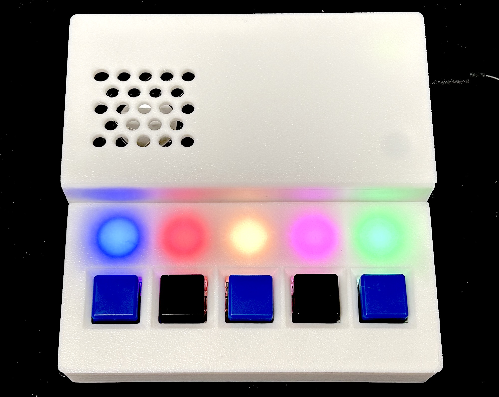

# bath-monitor



5人家族の我が家では、お風呂に最後に入った人が湯船の水を抜いて洗うことになっています。しかし、その運用には以下の問題があります。
- まだ入ってない人がいるのに、湯船が空になって洗われていた
- もうみんな入ったのに、まだ入っていない人がいると勘違いして、そのまま朝まで湯船が洗われなかった

その後、入った人は磁石で印を付けるようにしたのですが、その運用は徹底されず、たびたびお風呂に関する問題が起き続けています。  

この bath-monitor はそんな家族の問題を解決するために開発しました。  
bath-monitor は以下の機能を持っています。
- 家族ごとに５つのボタンを搭載。ボタンが押されると LED が点灯し、ボタンごとに異なるメロディを鳴らす
- ボタンの押し間違いがあったら、二秒の長押しで LED は消灯し、キャンセルできる
- 照度センサーを搭載し、脱衣所が明るいか暗いかで誰かが入っていることをセンシングする
- ボタンとセンサーの信号はWi-Fi経由で自宅LAN上のFlaskサーバーに送られ、サーバーはライブダッシュボードを表示
- 携帯や PC でダッシュボードにアクセスすれば、誰が入ったか、今誰かが入っているかをリアルタイムに検知可能

設計の詳細は`docs/design.md`、HTTPの契約(プロトコル)は`docs/protocol.md`、ピン割り当ては`docs/wiring.md`を参照してください。embassy-rpのPIOの不具合の調査記録と回避策は`docs/embassy-rp-pio-drop-bug.md`にまとめています。

また、筐体や電子回路の作り方については、fabble の方にまとめました。  
https://fabble.cc/kigakudoh/bathmonitor

## サーバー

```bash
cd server
python -m venv .venv && source .venv/bin/activate
pip install -r requirements.txt
python app.py            # 開発用サーバー(手元での確認用。警告が出るのは正常) http://<this-machine>:8080
python wsgi.py           # 本番用サーバー(waitress。Pi上ではこちら) 同じく :8080
```

テスト: `pytest tests/ -q`(`server/`ディレクトリで、venvを有効化した状態で実行)。

Raspberry Pi上でsystemdサービスとして24時間365日稼働させる方法(`wsgi.py`経由の本番用WSGIサーバー、自動起動・自動再起動)は`docs/deploy.md`を参照してください。

## ファームウェア

`rustup target add thumbv8m.main-none-eabihf`(RP2350はArm Cortex-M33のため)と、書き込み用に`picotool`をPATHに通しておく必要があります(デバッグプローブ不要 — 書き込みはBOOTSEL + `picotool`で行います。`elf2uf2-rs`はRP2350/RP235xでは動作しません)。

```bash
cp firmware/src/secrets.rs.example firmware/src/secrets.rs   # 実際のWi-Fi/サーバー情報を記入
cd firmware
cargo build --release     # コンパイルチェックのみ
cargo run --release       # ビルドし、BOOTSELモードのPico 2 Wにpicotool経由で書き込み
```

ログはUSBシリアル経由(`screen /dev/tty.usbmodemXXXX 115200`)で確認します(RTT/defmtではありません)。

- `XXXX`の部分: Pico 2 WをUSB接続した状態で`ls /dev/tty.usbmodem*`を実行すると確認できる(複数のUSBシリアルデバイスが繋がっている場合は、抜き差し前後で`ls`の差分を見ると確実)
- `screen`の終了方法: `Ctrl-a`の後に`k`を押し、確認プロンプトで`y`を押す(`Ctrl-a` `d`はデタッチのみでプロセスは残るため注意)

## 現在の状況

- 専用の基板が届き、試作機を1台組み立てて動作検証を行いました。2026-10-11から我が家で運用を開始しています
- サーバーは実機のRaspberry Pi 4上にデプロイ・動作確認済み(ダッシュボードに自宅LAN上のスマートフォンからアクセスできることを確認済み)
- 対象基板は Pico W から Pico 2 W(RP2350) に変更となり、ファームウェアのコードはRP2350向けに移行済みです(`thumbv8m.main-none-eabihf`向けに`cargo clippy`まで通過)
- その後2026-09-19に実機のPico 2 Wへ書き込み、Wi-Fi接続、ボタン(1個目)、MAX98357Aアンプからのメロディ、オンボードLED、サーバーへの送信は動作を確認済み
- 照度センサーは、センサーを覆うとデバウンスされた在室状態が`POST /api/occupancy`で送られ、サーバーのダッシュボードにも在室と表示されることを確認済みです(2026-09-20)
- NeoPixelは、点灯・白の呼吸・長押し取り消しでの消灯を確認済みです(白の呼吸は、SK6812RGBWを5個つないで、1秒周期の現在の見え方で確認。点灯と長押し取り消しはWS2812の時に確認)。
- ここまではブレッドボード上での確認です。基板で組んだ試作機では、さらに次の項目を確認しました(2026-10-11): 5個すべてのボタンと押した人ごとの色、最後の1人の専用メロディ、音量・音割れ、Wi-Fi切断後の再接続、オフライン中・サーバー停止中の押下/取り消しの再送、接続失敗時のオンボードLEDの「ピピ」
- 照度センサーのしきい値(トリムポット)を夜の脱衣所の明るさに合わせて調整しましたが、昼間は人がいなくてかなり暗い状態でも、在室と判断されてしまいます

### 今後の検討事項

実運用を続けながら検討します(詳細は`docs/additional_spec.md`)。

- 照度センサーによる在室判定を、時刻(昼か夜か)と組み合わせて行う
- 人が入っていないときは、NeoPixelをかなり暗くするか、完全に消す

### 報告記録

- Fablab浜松の定例会合にて
- CoderDojo浜松の発表
    - 2026/9/27 (`docs/slides/bath-monitor-intro.pptx`)
    - 2026/10/25
